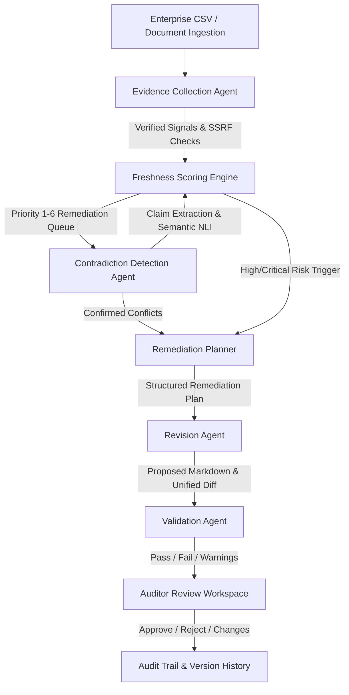

# FreshGuard AI

> **Enterprise AI-Assisted Content Freshness, Semantic Decay & Multi-Agent Remediation System**

FreshGuard AI empowers knowledge managers, onboarding leaders, IT departments, and enterprise content owners to systematically detect stale, rotting, and contradictory documents across enterprise knowledge repositories, generate evidence-grounded revisions, validate them independently, and submit them for human editorial review.

---

## 1. System Architecture & End-to-End Workflow

FreshGuard AI operates as an agentic pipeline connecting deterministic risk scoring, safe telemetry collection, semantic conflict detection, and multi-agent remediation:

```
[ CSV Ingestion / API ] ───▶ [ Evidence Collection Agent ]
                                     │ (URLs, Deprecations, Metadata)
                                     ▼
                          [ Freshness Scoring Engine ] ◀─── [ Human Reviews ]
                                     │ (0-100 Risk, Explanations)
                                     ▼
                         [ Contradiction Detection Agent ]
                                     │ (Claim Extraction, Pairwise NLI)
                                     ▼
                           [ Remediation Planner ]
                                     │ (Plan, Issues, Constraints)
                                     ▼
                             [ Revision Agent ]
                                     │ (Grounding, Diff Generation)
                                     ▼
                            [ Validation Agent ]
                                     │ (Independent Check, Hallucination Guard)
                                     ▼
                              [ Human Review ]
                             (Approve / Reject)
```



### Agent Responsibilities

1. **Evidence Collection Agent**:
   - **Safe URL Verification Tool**: Probes hyperlinks using strict SSRF guards (blocks loopback, RFC1918 subnets, link-local, AWS/GCP cloud metadata `169.254.169.254`), follows safe redirects, and enforces response streaming limits (64KB).
   - **Deprecated Reference Scanner**: Uses token boundary patterns (`\b`) to spot retired software (IE11, CentOS, Python 2, Skype for Business, AngularJS, SVN, etc.).
   - **Metadata Quality Inspector**: Detects missing identifiers, broken dates, and orphaned documents.
2. **Freshness Scoring Engine**:
   - Deterministic 0–100 risk scoring with granular signal attribution.
   - Transparent provisional scoring handling unknown signals (such as longitudinal view dropoffs).
   - Priority queue (Priority 1: Critical down to Priority 6: Insufficient telemetry).
3. **Contradiction Detection Agent**:
   - Clusters documents into subject-area pairs with actual text availability.
   - Extracts discrete claims (`policy_rule`, `procedure_step`, `approval_requirement`, `numerical_limit`).
   - Uses OpenAI API (`gpt-4o-mini`) or deterministic cross-document sentence analysis to classify relationships (`contradiction`, `supersession`, `scope_difference`, `complementary`).
   - Temporal authority weighting: recognizes when newer policies supersede older guidance.
4. **Remediation Planner**:
   - Synthesizes document metadata, age, confirmed broken URLs, deprecated tool findings, and active contradictions into a structured, step-by-step remediation plan with explicit style constraints.
5. **Revision Agent**:
   - Rewrites document text grounded strictly in verified evidence and the remediation plan.
   - Generates unified diffs without modifying the original source document.
6. **Validation Agent**:
   - Evaluates the proposed draft independently from the revision agent.
   - Verifies evidence grounding, detects hallucinations or unresolved contradictions, and flags regression warnings.
7. **Human Auditor Review**:
   - Visual side-by-side diff workspace.
   - Decision controls: **Approve**, **Reject**, or **Request Changes**.
   - Preserves complete revision and audit logs.
   - **Step 4: Cross-Document Contradiction Detection:** Compare conflicting security policies side by side; observe temporal recency analysis identifying which policy is authoritative.
   - **Step 5: Multi-Agent Remediation:** Trigger the Remediation Workflow for a stale document. Observe the Planner generating a structured roadmap, the Revision Agent creating a unified diff, and the Independent Validator verifying grounding.
   - **Step 6: Human Editorial Approval:** Review proposed changes in the side-by-side workspace and submit an editorial decision (Approve / Reject).
4. **Architecture & Scalability:** Explain the containerized Cloud Run single-service pattern, asynchronous task queues, and external database migration roadmap.
