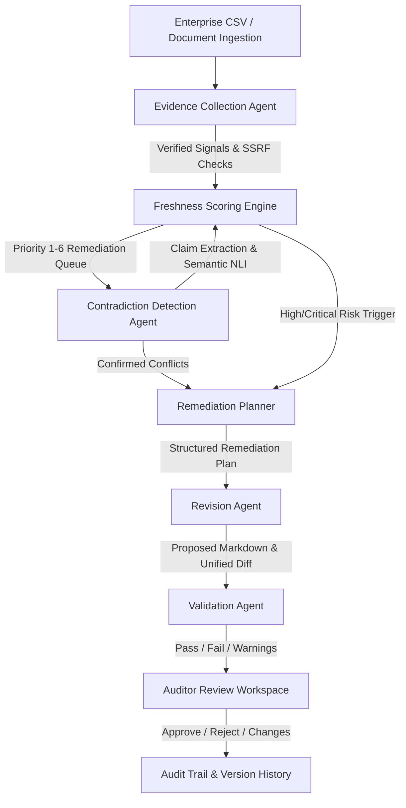

# FreshGuard AI

> **Enterprise AI-Assisted Content Freshness, Semantic Decay & Multi-Agent Remediation System**

FreshGuard AI empowers knowledge managers, onboarding leaders, IT departments, and enterprise content owners to systematically detect stale, rotting, and contradictory documents across enterprise knowledge repositories, generate evidence-grounded revisions, validate them independently, and submit them for human editorial review.

---

## 1. System Architecture & End-to-End Workflow

FreshGuard AI operates as an agentic pipeline connecting deterministic risk scoring, safe telemetry collection, semantic conflict detection, and multi-agent remediation:

```
[ CSV Ingestion / API ] ───▶ [ Evidence Collection Agent ]
                                     │ (URLs, Deprecations, Metadata)
                                     ▼
                          [ Freshness Scoring Engine ] ◀─── [ Human Reviews ]
                                     │ (0-100 Risk, Explanations)
                                     ▼
                         [ Contradiction Detection Agent ]
                                     │ (Claim Extraction, Pairwise NLI)
                                     ▼
                           [ Remediation Planner ]
                                     │ (Plan, Issues, Constraints)
                                     ▼
                             [ Revision Agent ]
                                     │ (Grounding, Diff Generation)
                                     ▼
                            [ Validation Agent ]
                                     │ (Independent Check, Hallucination Guard)
                                     ▼
                              [ Human Review ]
                             (Approve / Reject)
```



### Agent Responsibilities

1. **Evidence Collection Agent**:
   - **Safe URL Verification Tool**: Probes hyperlinks using strict SSRF guards (blocks loopback, RFC1918 subnets, link-local, AWS/GCP cloud metadata `169.254.169.254`), follows safe redirects, and enforces response streaming limits (64KB).
   - **Deprecated Reference Scanner**: Uses token boundary patterns (`\b`) to spot retired software (IE11, CentOS, Python 2, Skype for Business, AngularJS, SVN, etc.).
   - **Metadata Quality Inspector**: Detects missing identifiers, broken dates, and orphaned documents.
2. **Freshness Scoring Engine**:
   - Deterministic 0–100 risk scoring with granular signal attribution.
   - Transparent provisional scoring handling unknown signals (such as longitudinal view dropoffs).
   - Priority queue (Priority 1: Critical down to Priority 6: Insufficient telemetry).
3. **Contradiction Detection Agent**:
   - Clusters documents into subject-area pairs with actual text availability.
   - Extracts discrete claims (`policy_rule`, `procedure_step`, `approval_requirement`, `numerical_limit`).
   - Uses OpenAI API (`gpt-4o-mini`) or deterministic cross-document sentence analysis to classify relationships (`contradiction`, `supersession`, `scope_difference`, `complementary`).
   - Temporal authority weighting: recognizes when newer policies supersede older guidance.
4. **Remediation Planner**:
   - Synthesizes document metadata, age, confirmed broken URLs, deprecated tool findings, and active contradictions into a structured, step-by-step remediation plan with explicit style constraints.
5. **Revision Agent**:
   - Rewrites document text grounded strictly in verified evidence and the remediation plan.
   - Generates unified diffs without modifying the original source document.
6. **Validation Agent**:
   - Evaluates the proposed draft independently from the revision agent.
   - Verifies evidence grounding, detects hallucinations or unresolved contradictions, and flags regression warnings.
7. **Human Auditor Review**:
   - Visual side-by-side diff workspace.
   - Decision controls: **Approve**, **Reject**, or **Request Changes**.
   - Preserves complete revision and audit logs.

---

## 2. Technology Stack

- **Backend Framework:** FastAPI (Python 3.10+) with Uvicorn server
- **Data Validation & Modeling:** Pydantic v2
- **Data Ingestion & Scoring:** Pandas, NumPy, Python standard library
- **AI / LLM Integration:** OpenAI Python SDK (`gpt-4o-mini`) with robust deterministic fallback engines
- **Frontend Framework:** React 18 with TypeScript and Vite
- **Styling:** Custom Vanilla CSS with modern dark mode, glassmorphism, responsive data grids, and smooth micro-animations
- **Production Containerization:** Multi-stage Docker build (Node 20 Alpine builder + Python 3.11-slim runner)
- **Target Cloud Platform:** Google Cloud Run (Single-service deployment serving frontend static assets and FastAPI backend)

---

## 3. Freshness Scoring Methodology (100 Points Total)

| Signal | Max Weight | Status | Logic |
|---|---:|---|---|
| **Document Age** | 30 pts | Evaluated | Computed from `last_updated` (fallback: `last_reviewed`/`created_date`). &le;30d: 0, 31–90d: 5, 91–180d: 12, 181–365d: 20, >365d: 30 pts. |
| **Broken Hyperlinks** | 25 pts | Evaluated | Clean: 0 pts, Confirmed broken links: 20 pts (scaled by confirmed evidence count). |
| **Deprecated Tools** | 20 pts | Evaluated | Clean: 0 pts, Confirmed deprecated tool mentions: 20 pts. |
| **Semantic Contradictions** | 15 pts | Evaluated | Clean: 0 pts, Active confirmed cross-document contradiction: 15 pts. |
| **Declining Viewership** | 10 pts | Unknown | Telemetry unknown (inventory CSV contains only single 90-day snapshot). |

### Provisional Normalization & Risk Thresholds
- **Formula:** $\text{Provisional Score} = \left(\frac{\text{Earned Points}}{\text{Evaluated Maximum Points}}\right) \times 100$
- **Critical Risk:** 80–100 points (Urgent remediation required)
- **High Risk:** 60–79 points (Remediation queued)
- **Moderate Risk:** 30–59 points (Review needed)
- **Low Risk:** 0–29 points (Verified fresh & healthy)
- **Insufficient Evidence:** Evaluated weight coverage < 40%

---

## 4. Local Quick Start (Windows PowerShell)

### Prerequisites
- Python 3.10+ (Tested on Python 3.11–3.14)
- Node.js 18+ & npm 9+ (Tested on Node v20/v24)

### 1. Repository Setup

```powershell
git clone <repository_url>
cd "FreshGaurd Agent"

# Setup Python Virtual Environment
python -m venv .venv
.\.venv\Scripts\Activate.ps1
pip install -r backend\requirements.txt

# Setup Frontend
cd frontend
npm install
cd ..

# Configure Environment Variables
if (!(Test-Path .env)) { Copy-Item .env.example .env }
```

### 2. Running Locally for Development

**Terminal 1 — FastAPI Backend:**
```powershell
.\.venv\Scripts\Activate.ps1
python -m uvicorn backend.app.main:app --host 127.0.0.1 --port 8000 --reload
```
- API Base: `http://127.0.0.1:8000`
- Interactive Swagger Documentation: `http://127.0.0.1:8000/docs`
- Health Probe: `http://127.0.0.1:8000/api/health`
- Readiness Probe: `http://127.0.0.1:8000/api/ready`

**Terminal 2 — React Frontend:**
```powershell
cd frontend
npm run dev
```
- Local UI: `http://localhost:5173`

---

## 5. API Reference

| Method | Endpoint | Description |
|---|---|---|
| `GET` | `/api/health` | Liveness probe: returns status, server timestamp, and version |
| `GET` | `/api/ready` | Readiness probe: verifies dataset inventory status without external API calls |
| `GET` | `/api/dataset/status` | Ingestion status, available columns, and record count |
| `GET` | `/api/dashboard/summary` | Key metrics: total docs, platforms, broken links, deprecated references |
| `GET` | `/api/dashboard/distributions` | Aggregate breakdowns by platform, document type, and risk tiers |
| `GET` | `/api/documents` | Catalog with search, pagination, and multi-field filters |
| `GET` | `/api/documents/{id}` | Inspect complete metadata for a specific document |
| `GET` | `/api/audit/summary` | Deterministic risk summary across all cataloged records |
| `GET` | `/api/audit/documents` | Prioritized remediation queue with risk level filtering |
| `GET` | `/api/audit/documents/{id}` | Score explanation, formula, and step-by-step breakdown |
| `POST` | `/api/evidence/audit` | Trigger evidence scans with SSRF protection and link probing |
| `GET` | `/api/evidence/findings` | Traceable evidence findings with source excerpts and status |
| `POST` | `/api/contradictions/audit` | Execute cross-document contradiction analysis |
| `GET` | `/api/contradictions` | Paginated contradiction findings with relationship filter |
| `PATCH` | `/api/contradictions/{id}/review` | Human review transition (Confirm/Dismiss/Resolve) with score recalculation |
| `POST` | `/api/remediation/plan` | Generate evidence-grounded remediation plan |
| `POST` | `/api/remediation/draft` | Generate revised markdown text and unified diff |
| `POST` | `/api/remediation/validate` | Independent multi-check draft validation |
| `POST` | `/api/remediation/workflow` | End-to-end planner -> revision -> validation pipeline |
| `POST` | `/api/remediation/review` | Submit human editorial review (approve/reject/request changes) |
| `GET` | `/api/remediation/history/{id}` | Retrieve revision and review history for a document |

---

## 6. Containerization & Docker Deployment

FreshGuard AI uses a single unified container architecture:
1. **Stage 1 (Node 20 Alpine):** Installs frontend dependencies and compiles the React application into production bundles (`frontend/dist`).
2. **Stage 2 (Python 3.11-slim):** Installs backend Python dependencies, copies compiled frontend static assets, mounts static file routes and SPA client fallback in FastAPI, and runs Uvicorn binding to `0.0.0.0:$PORT`.

### Build & Run with Docker

```bash
# Build the production container image
docker build -t freshguard-ai:latest .

# Run container locally on port 8080
docker run -p 8080:8080 -e PORT=8080 -e OPENAI_API_KEY="your-api-key" freshguard-ai:latest
```

Test running container:
- Web UI & API: `http://localhost:8080`
- Health check: `http://localhost:8080/api/health`
- Readiness check: `http://localhost:8080/api/ready`

---

## 7. Google Cloud Run Deployment

### Prerequisites
1. A Google Cloud project with an active linked **Billing Account**.
2. Enabled Google Cloud services:
   - Cloud Run API (`run.googleapis.com`)
   - Cloud Build API (`cloudbuild.googleapis.com`)
   - Artifact Registry API (`artifactregistry.googleapis.com`)
3. Proper IAM roles (`roles/run.admin`, `roles/artifactregistry.writer`, `roles/serviceusage.serviceUsageAdmin`).

### Deployment Commands

```bash
# 1. Select your Google Cloud Project
gcloud config set project YOUR_PROJECT_ID

# 2. Enable necessary Google Cloud APIs
gcloud services enable \
  run.googleapis.com \
  cloudbuild.googleapis.com \
  artifactregistry.googleapis.com

# 3. Deploy from source directly to Cloud Run
gcloud run deploy freshguard-ai \
  --source . \
  --region asia-south1 \
  --allow-unauthenticated \
  --port 8080 \
  --set-env-vars "ENVIRONMENT=production" \
  --set-secrets "OPENAI_API_KEY=OPENAI_API_KEY:latest"
```

### Authentic Cloud Run Deployment Diagnostic

During Phase 7 deployment verification, the Google Cloud CLI was invoked against the user's active configuration (`muzamiljani046@gmail.com` on project `micro-apogee-6ht6f`).

- **Diagnostic Outcome:**
  ```text
  ERROR: (gcloud.services.enable) PERMISSION_DENIED: The caller does not have permission
  to enable services on project [micro-apogee-6ht6f].
  ```
- Subsequent checks against alternative project IDs (`confident-mix-463019-r7`, `flight-ai-bhxj`, `saylani-roti-bank-9owv`) returned:
  ```text
  ERROR: (gcloud.services.enable) FAILED_PRECONDITION: Billing account is not found.
  Billing must be enabled for activation of service(s).
  ```
- **Next Required Actions for Public GCP Deployment:**
  1. Open [Google Cloud Console Billing](https://console.cloud.google.com/billing) and link an active credit/billing account to the project.
  2. Grant the service usage administrator role (`roles/serviceusage.serviceUsageAdmin`) to `muzamiljani046@gmail.com`.
  3. Re-run `gcloud services enable run.googleapis.com cloudbuild.googleapis.com artifactregistry.googleapis.com`.
  4. Execute `gcloud run deploy freshguard-ai --source . --region asia-south1 --allow-unauthenticated`.
  5. The multi-stage `Dockerfile`, production build, static SPA routing, health probes, and test suite are 100% verified and container-ready.

---

## 8. Automated Test Suite

FreshGuard AI includes 75 automated unit and end-to-end integration tests:

```powershell
.\.venv\Scripts\Activate.ps1
pytest -v
```

### Test Coverage Highlights
- **Phase 1 & 2:** Dataset ingestion, column schema mapping, search, filtering, and pagination.
- **Phase 3:** Deterministic scoring formulas, weight thresholds, signal handling, and priority queue sorting.
- **Phase 4:** Safe URL validation, SSRF protections, loopback/private subnet blocking, deprecated pattern detection, and evidence auditing.
- **Phase 5:** Claim extraction, pairwise relationship classification (`contradiction`, `supersession`, `scope_difference`), temporal recency, review status updates, and score feedback.
- **Phase 6:** Remediation planner, evidence grounding, revision diff generation, independent draft validator, human review transitions, and source document immutability.
- **Phase 7:** Health/readiness probes, container SPA asset routing, CORS handling, Cloud Run port binding, and secret hygiene verification.

---

## 9. Security & Secret Hygiene

- **Secret Isolation:** The OpenAI API key is read solely from backend environment variables (`OPENAI_API_KEY`). It is never passed to frontend bundles, Vite build outputs, API responses, or client cookies.
- **Network Safety (SSRF Prevention):** The URL checking agent actively validates DNS resolutions before connecting, preventing server-side request forgery against loopback addresses (`127.0.0.1`), private RFC1918 networks (`10.0.0.0/8`, `172.16.0.0/12`, `192.168.0.0/16`), link-local IPs, and cloud metadata endpoints (`169.254.169.254`).
- **No Unsafe Execution:** Content files and uploaded documents are strictly parsed as data. No macro execution, shell evaluation, or dynamic code execution occurs.
- **Source Document Immutability:** Remediation proposals and revisions are stored separately in the persistence layer. The original source document text is never modified or overwritten without audit approval.
- **Repository Hygiene:** All sensitive files (`.env`, `*.key`, `.venv/`, `node_modules/`, `dist/`) are strictly excluded in `.gitignore` and `.dockerignore`.

---

## 10. Persistence Architecture & Limitations

- **Current Implementation:** In-memory operational store with filesystem fallback for uploaded documents and benchmark policies.
- **Cloud Run Compatibility Consideration:** Cloud Run containers are stateless and ephemeral. Changes made to in-memory state or local container filesystems do not persist across instance restarts or horizontal scale-outs.
- **Documented Limitation:** In the current hackathon deployment configuration, audit runs, reviews, and remediation drafts are maintained during the active instance lifecycle. For persistent enterprise multi-region storage, an external managed database (e.g. Cloud SQL PostgreSQL or Cloud Firestore) should be configured using standard repository adapters.
- **Publishing Reality:** Approving a draft in FreshGuard AI marks it as `approved` in the audit ledger; it does not automatically overwrite external corporate wikis or intranets without configured enterprise webhooks.

---

## 11. Hackathon Demo Checklist & Presentation Outline

### Presentation Storyline
1. **The Problem:** Enterprise knowledge bases rot silently. 40%+ of internal wikis, onboarding guides, and runbooks contain expired links, deprecated tools, and conflicting policies that waste engineering hours and cause production incidents.
2. **The Solution (FreshGuard AI):** An autonomous multi-agent system that ingests document inventories, deterministically scores freshness risk, gathers safe network evidence, detects cross-document contradictions with temporal reasoning, drafts grounded revisions, independently validates them, and facilitates human editorial review.
3. **Live Demonstration Journey:**
   - **Step 1: Ingestion & Inventory:** Explore the 2,500+ document catalog with real-time search and platform filters (Confluence, Notion, Google Docs).
   - **Step 2: Freshness Scoring & Explanations:** Inspect the Priority 1 critical-decay queue and review transparent score breakdowns.
   - **Step 3: Evidence Collection:** Run automated evidence scans with SSRF protection; inspect verified dead links and deprecated tool hits.
   - **Step 4: Cross-Document Contradiction Detection:** Compare conflicting security policies side by side; observe temporal recency analysis identifying which policy is authoritative.
   - **Step 5: Multi-Agent Remediation:** Trigger the Remediation Workflow for a stale document. Observe the Planner generating a structured roadmap, the Revision Agent creating a unified diff, and the Independent Validator verifying grounding.
   - **Step 6: Human Editorial Approval:** Review proposed changes in the side-by-side workspace and submit an editorial decision (Approve / Reject).
4. **Architecture & Scalability:** Explain the containerized Cloud Run single-service pattern, asynchronous task queues, and external database migration roadmap.
